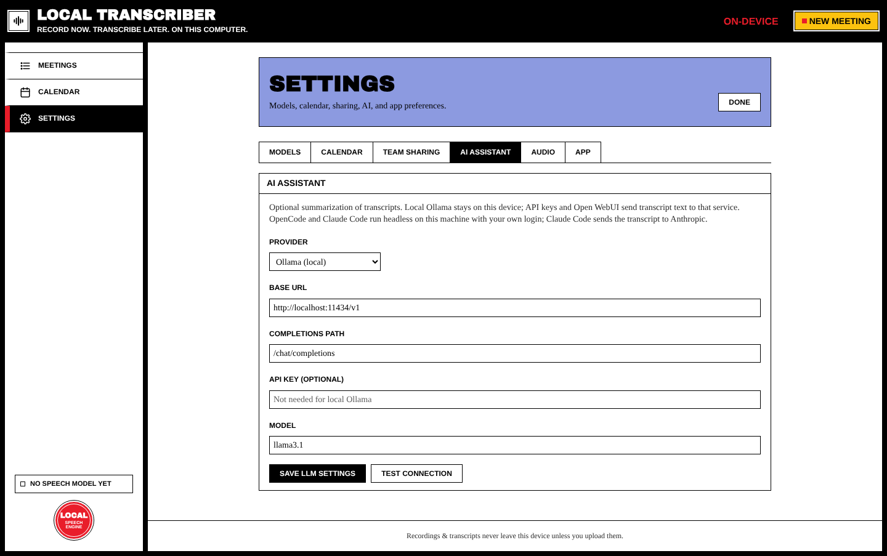

# AI Summaries

Local Transcriber can turn a transcript into a **summary**, **key points** and **action items** using a large language model (LLM). This is optional. Choose a provider in **Settings → AI assistant**.

## Providers

| Provider | Where the transcript goes | Notes |
| --- | --- | --- |
| **Ollama (local)** | **Stays on this computer** | Recommended for privacy. Install [Ollama](https://ollama.com), run `ollama pull llama3.1`, keep the default base URL `http://localhost:11434/v1`. |
| **OpenAI-compatible API** | The provider you configure | Any endpoint that supports `/chat/completions`. Needs an API key. |
| **Open WebUI** | Your Open WebUI server | Use its API base URL and key. |
| **OpenCode (local agent)** | The model provider behind your OpenCode login | Needs the desktop app and the OpenCode CLI. It runs `opencode run` headless; enter a `provider/model` id (see `opencode models`). No URL or key needed. |
| **Claude Code** | Anthropic | Runs headless on this machine with your own login. |
| **Custom** | Wherever you point it | Set every field yourself. |

> ⚠️ This is the one feature that sends **transcript text** off your device, unless you use local Ollama. Audio is never sent.

## Fields

| Field | Example |
| --- | --- |
| **Provider** | Ollama (local) |
| **Base URL** | `http://localhost:11434/v1` |
| **Completions path** | `/chat/completions` |
| **API key (optional)** | Not needed for local Ollama |
| **Model** | `llama3.1` |

Press **Save LLM settings**, then **Test connection**. It sends a one-word test message.

## Use it

On a transcribed meeting, press **Summarize with LLM** (or **Re-summarize**). The summary is saved with the meeting, shows up in the meetings list and in search, and can be uploaded to GitLab.

From the **action items** you can create [[GitLab Sharing#action-items--issues|GitLab issues]] or [[Calendar Integration|calendar events]].
