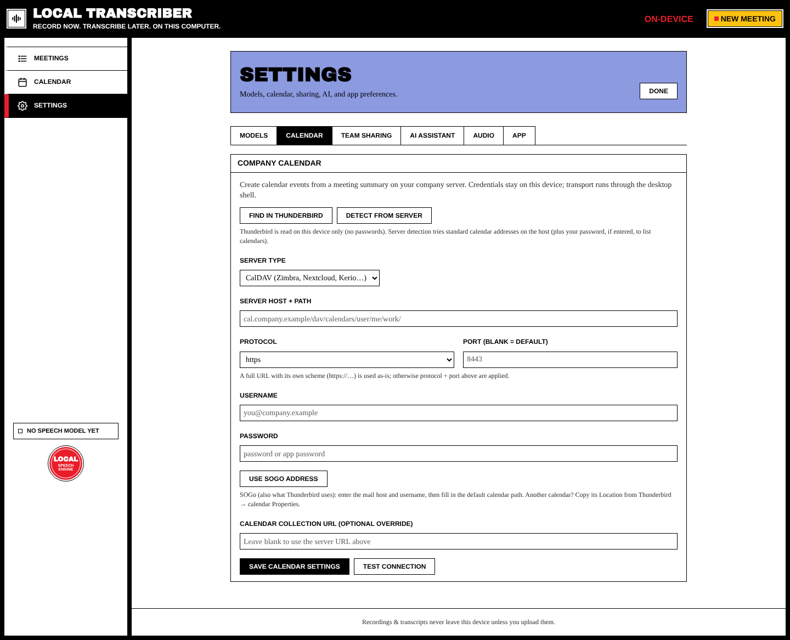
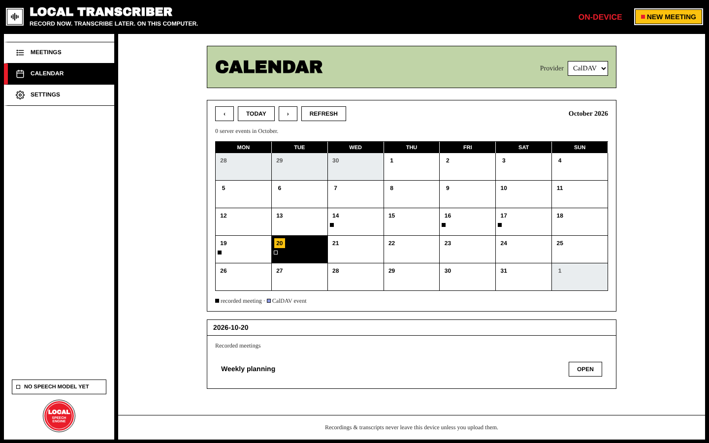

# Calendar Integration

Connect your company calendar to:

- see **recorded meetings** and **server events** together in the **Calendar** view,
- turn summary action items into **follow-up events**. Each one is a draft you edit, and **nothing reaches the server until you click Approve**.

Credentials stay on this device.

## Supported servers

| Server type | Examples |
| --- | --- |
| **CalDAV** | SOGo, Nextcloud, Zimbra, Kerio and other CalDAV servers |
| **Microsoft Graph** | Microsoft 365 / Outlook.com |
| **Exchange EWS** | On-premises Exchange |

## Set up (Settings → Calendar)

Your mail settings (IMAP/SMTP) don't include calendars, so there are shortcuts to find the right address:

- **Find in Thunderbird** reuses the calendars Thunderbird already knows. It reads them on this device only, without passwords.
- **Detect from server** tries the usual calendar addresses on your host and lists your calendars. It uses your password, if you entered one, to list them.
- **Use SOGo address** fills in the default SOGo calendar path from your mail host and username. For another calendar, copy its *Location* from Thunderbird → calendar **Properties**.

Or fill the fields in yourself:

| Field | Notes |
| --- | --- |
| **Server type** | CalDAV / Microsoft Graph / Exchange EWS |
| **Server host + path** | e.g. `cal.company.example/dav/calendars/user/me/work/` |
| **Protocol / Port** | A full URL that includes `https://…` is used as it is. Otherwise the protocol and port are added (leave the port blank for the default). |
| **Username / Password** | Use an app password if your server supports them |
| **Calendar collection URL** | Optional override. Leave it blank to use the server URL. |

Press **Save calendar settings**, then **Test connection**.

## Calendar view

**Calendar** in the sidebar shows a month. Each day lists your **Recorded meetings** and the **Server events** from your calendar. Each month is kept on your device, so it opens instantly and still works offline.

## Follow-up events from a meeting

1. Summarize the meeting (see [[AI Summaries]]).
2. Tick action items in the summary.
3. In the **Calendar event** section, press **Prepare calendar events**. You get one editable draft per item, or you can prepare a custom event.
4. Edit the title, start, end, location (optional) and description.
5. Press **Approve & create on server** (or **Approve & create N events** for several drafts). Only then is anything sent to your calendar. Created events are listed under *Events created from this meeting*.

A meeting can have several follow-up events.
