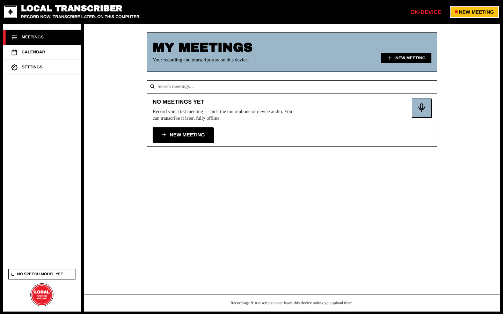
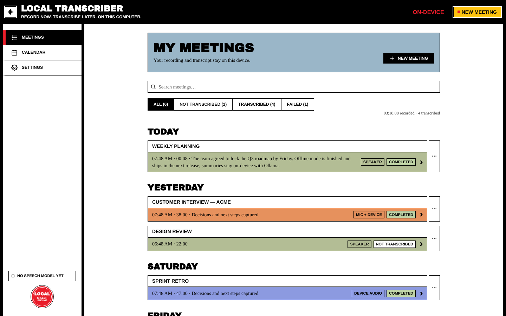

# Getting Started

## First launch

When you open Local Transcriber for the first time, the meetings list is empty and the app offers to set up on-device transcription.

- **Recording works right away.** You don't need a speech model to record.
- To transcribe, click **Set up transcription** on the red card. The app downloads the default speech model (`large-v3-turbo`, about 550 MB) once, with a progress bar. After that, transcription works fully offline.
- To pick a different model, click **Choose another model**. See [[Transcription#speech-models]].

> On macOS, allow microphone access when asked. On Windows and Linux, the OS may ask the first time you record.

## The main window

| Area | What it does |
| --- | --- |
| **Top bar** | App name (click it to go back to the meetings list). On the right, **ON-DEVICE** turns into a red **REC 00:00** clock while you record; click it to go back to the recording. The yellow **New meeting** button starts a new recording (`Ctrl/Cmd+N`). |
| **Sidebar** | **Meetings**, **Recording…** (only while recording), **Calendar** and **Settings**. Lower down it shows the speech-model status (e.g. *No speech model yet*), any transcription running in the background, and update notices. |
| **Content** | The current screen: meetings list, new meeting, active recording, meeting details, calendar or settings. |

## Your first meeting in 60 seconds

1. Click **New meeting**.
2. Choose **Speaker** (an in-room meeting) or **Mic + Device** (an online call, wear headphones).
3. Optionally give it a name and an agenda, then press **● Start Recording**.
4. When you're done, press **■ Stop & save** and confirm.
5. On the meeting page, press **Transcribe** (or **Download model & transcribe**).
6. Optionally press **Summarize with LLM** to get a summary, key points and action items (needs [[AI Summaries]] set up).

Each step is explained in detail in [[Recording a Meeting]], [[Transcription]] and [[Meeting Details]].

## Where your data lives

- Meetings, transcripts and settings are stored **inside the app** on this computer.
- Each finished meeting is also copied to a normal folder you can browse:
  `~/Documents/Local Transcribe/<title-id>/` (audio, transcript, manifest). You can turn this off and open the folder from [[Settings#app]].
- Nothing is uploaded unless you turn on an integration yourself. See [[Privacy]].
