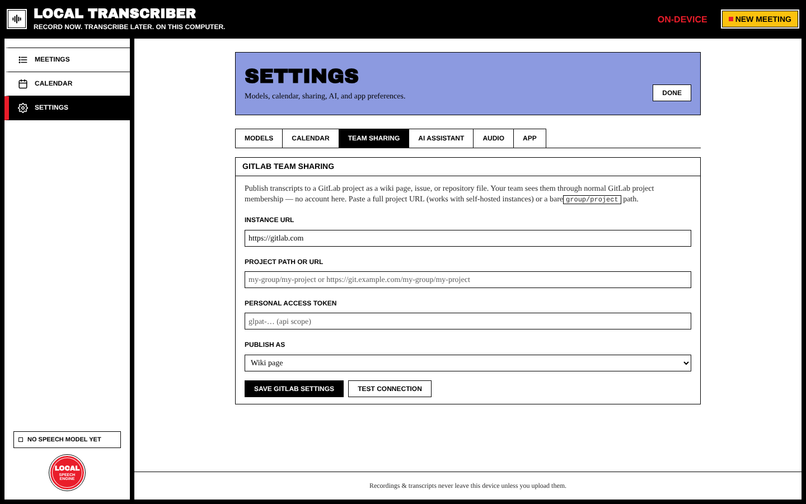

# GitLab Sharing

Share transcripts, summaries and agendas with your team through **GitLab**, with no backend of ours in between. Your team reads them with normal GitLab project membership.

## Set up (Settings → Team sharing)



| Field | Notes |
| --- | --- |
| **Instance URL** | `https://gitlab.com` by default. For self-hosted GitLab, use your server's URL. |
| **Project path or URL** | `group/project`, or paste the full project URL. Pasting a URL fills in the instance for you. |
| **Personal access token** | `glpat-…` with **`api`** scope. It's stored only on this device. |
| **Publish as** | **Wiki page**, **Issue**, or **Repository file** |

Press **Save GitLab settings**, then **Test connection**. This checks the token and the project.

## Upload a meeting

On a meeting page, in **Export & share → GitLab**:

- **Upload to GitLab** publishes the transcript, then shows an **Open in GitLab** link.
- **Upload summary** (once the meeting has a summary) publishes the summary:
  - *Wiki* target: a companion wiki page
  - *Repository* target: `summary.md` next to the transcript
  - *Issue* target: not supported
- The agenda can be uploaded too.

Repository uploads go into one folder per meeting:

```
meetings/<title>-<id>/transcript.md
meetings/<title>-<id>/summary.md
```

Uploading again updates the files.

## Action items → issues

After an AI summary, tick action items and choose **GitLab issues**. Each item becomes an editable draft (title, assignee…). Nothing is created until you approve. Created issues are linked on the meeting page.
