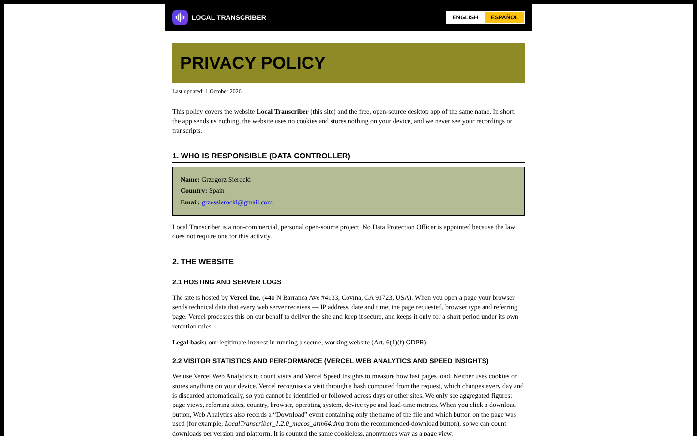
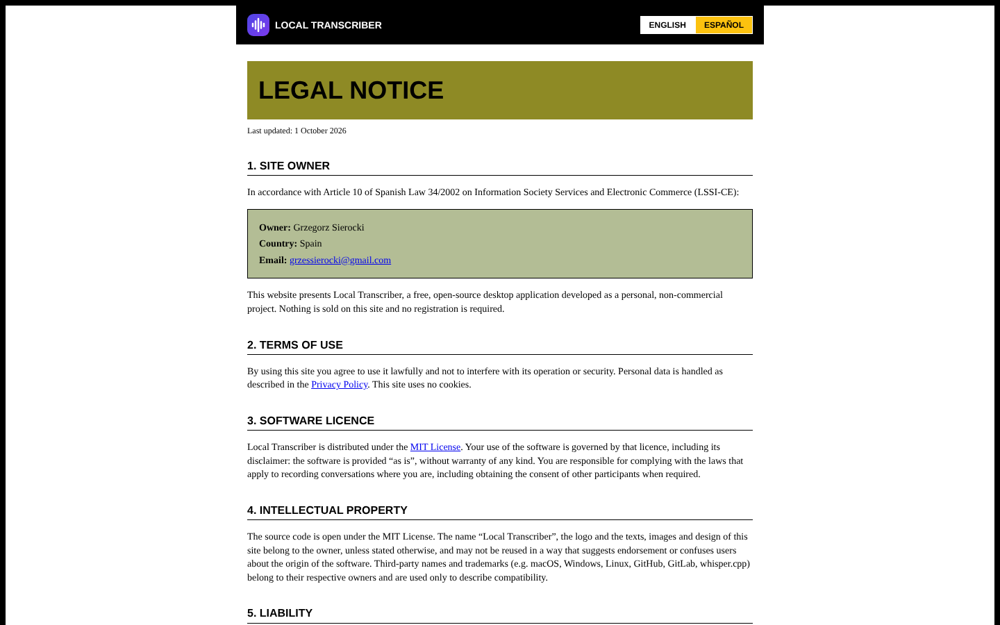

# Legal Pages

The site has two bilingual pages (English first, then Spanish), linked from the footer. With `cleanUrls` on Vercel they're served at `/privacy` and `/legal`.

| Privacy policy | Legal notice |
| --- | --- |
|  |  |

## `privacy.html`: Privacy Policy / Política de privacidad (GDPR, LOPDGDD)

1. Who is responsible (data controller)
2. The website (hosting, Vercel Analytics, GitHub API)
3. The desktop app
4. Recipients and international transfers
5. Retention
6. Your rights
7. Children
8. Changes

## `legal.html`: Legal Notice / Aviso legal (LSSI-CE art. 10)

1. Site owner
2. Terms of use
3. Software licence
4. Intellectual property
5. Liability
6. Applicable law and jurisdiction

## Maintenance rules

- The owner's name and contact email appear in **both** files. Keep them in sync.
- If the site starts collecting anything new (cookies, `localStorage`, forms, other third-party scripts), **update `privacy.html` first**.
- Both pages share `legal.css`.
