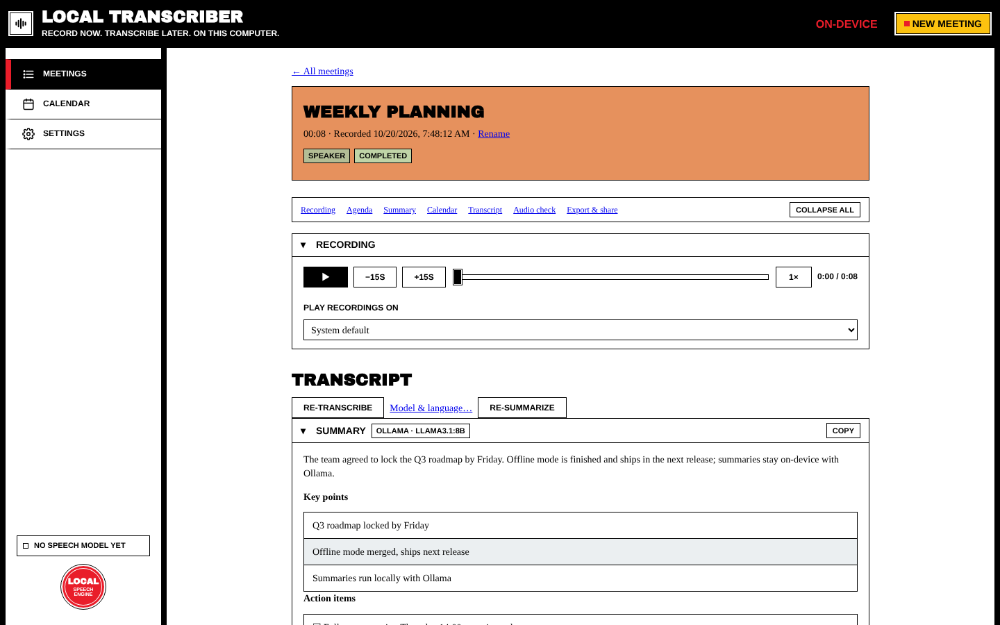
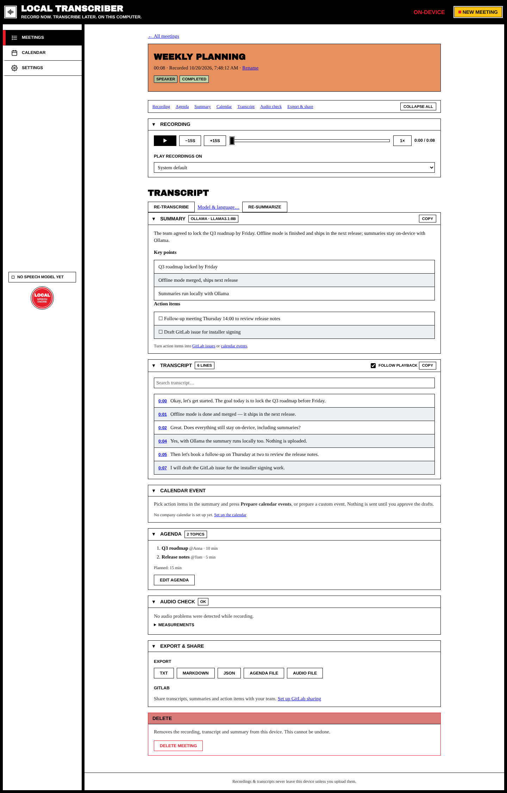

# Meeting Details

Click any meeting in the list to open its page. Everything about the meeting is here: the recording, the transcript, the summary, the agenda, calendar follow-ups, export and delete.

## Header

Shows the title, duration, recording date, and the **mode** and **status** labels (*Speaker / Device Audio / Mic + Device / Imported audio* and *not transcribed / processing / completed / failed*). Click **Rename** to change the title (`Enter` saves, `Esc` cancels).

The **jump bar** under the header (Recording · Agenda · Summary · Calendar · Transcript · Audio check · Export & share) scrolls to a section. **Collapse all** folds every section, which helps with long meetings.

## Recording (playback)

- **▶ / ❚❚** play and pause (`Space`)
- **−15s / +15s** skip (`←` / `→`)
- Drag the seek bar
- **1×** changes the speed (1× to 2×) without the chipmunk voice
- **Play recordings on** picks the output device

## Transcript

Full page view of a transcribed meeting:

- Each line has a **timestamp**. Click it to play from there.
- **Follow playback** highlights the line being played and scrolls to it.
- **Search transcript** (`Ctrl/Cmd+F`) highlights matches on this page.
- **Copy** copies the whole transcript.
- **Re-transcribe** / **Model & language…** run transcription again (see [[Transcription]]).
- Lines from older two-track recordings are labeled **Me** / **Others**.

## Summary

Press **Summarize with LLM** (or **Re-summarize**) to get, from your configured AI assistant:

- a short **summary**,
- **key points**,
- **action items** with checkboxes.

The label next to the heading shows which model wrote it. Under the action items: *"Turn action items into GitLab issues or calendar events"*. Tick the items you want and use those links. Setup: [[AI Summaries]].

## Calendar event

Turns the action items you ticked (or a custom event) into **editable drafts**: title, start, end, location, description. **Nothing is sent to your calendar until you approve each draft.** Events created from the meeting are listed under *Events created from this meeting*. Setup: [[Calendar Integration]].

## Agenda

Shows the planned topics with owner and minutes, plus the total planned time. **Edit agenda** lets you change it, during or after the meeting.

## Audio check

Shows the audio health measured while recording, such as clipping, silence or gaps. **OK** means no problems were found. **Measurements** has the details.

## Export & share

| Button | Output |
| --- | --- |
| **TXT** | Plain-text transcript (with the agenda, if there is one) |
| **Markdown** | Formatted transcript |
| **JSON** | Structured transcript with timestamps |
| **Agenda file** | The agenda alone |
| **Audio file** | The original recording |

**GitLab** uploads the transcript, the summary or the agenda to your team's GitLab project (with **Open in GitLab** links after uploading). Setup: [[GitLab Sharing]].

## Delete

**Delete meeting** removes the recording, transcript and summary from this device, including every audio chunk and database entry. **This can't be undone.** Copies you exported yourself, or uploaded to GitLab, are not affected.
