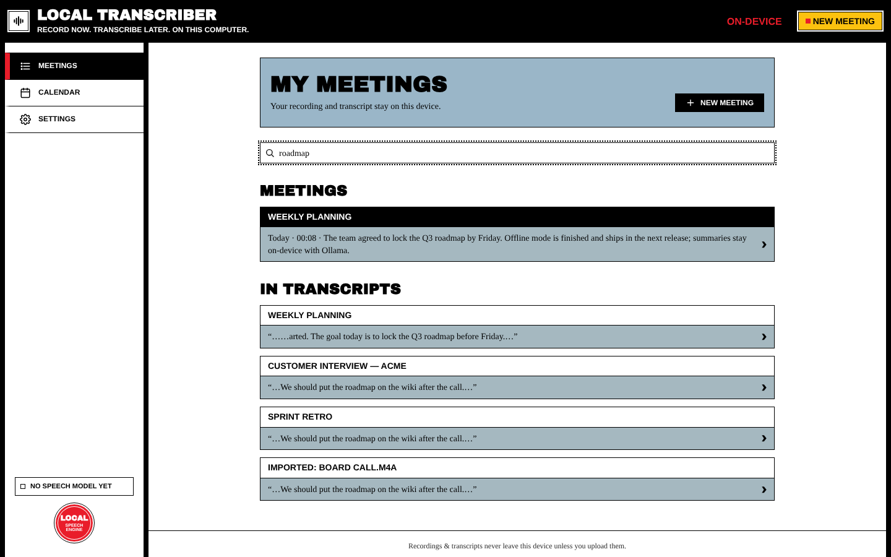
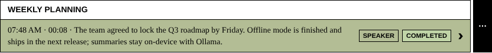

# Meetings List and Search

**Meetings** in the sidebar opens *My Meetings*, the home screen of the app.

## The list

- Meetings are grouped by day (**Today**, **Yesterday**, weekday names, then dates), newest first.
- Each row shows the title, start time, duration, the first line of the summary (if there is one), the **mode** label and the **transcription status** label. The row color matches the recording mode.
- Above the list: **total recorded time** and **how many meetings are transcribed**.
- After 50 meetings, **Show more (N older)** loads the next batch.

## Filters

| Filter | Shows |
| --- | --- |
| **All** | Every meeting |
| **Not transcribed** | Not transcribed yet, or transcribing now |
| **Transcribed** | Transcription finished |
| **Failed** | The last transcription failed (open the meeting to retry) |

A filter only appears when at least one meeting matches it. The number in brackets is the count.

## Search

Type in **Search meetings…** to search **every meeting at once**:

- **Meetings** lists meetings whose **title or summary** matches.
- **In transcripts** lists matching sentences from every transcribed meeting, with a snippet of each.

Clicking a transcript result opens the meeting with the search already applied. Your search stays in place when you come back to the list.

## Rename or delete from the list

Click **⋯** at the end of a row:

- **Rename** edits the title in place (**Save** / **Cancel**, `Esc` to cancel).
- **Delete** asks you to confirm, then removes the meeting and all its local data.

## Banners you may see

| Banner | Meaning |
| --- | --- |
| **An unfinished recording was found.** | The app stopped during a recording. **Recover Recording** or **Delete**. See [[Recording a Meeting#crash-recovery]]. |
| **Set up on-device transcription** | No speech model yet. One click downloads it. |
| **Transcription engine not found** | No engine is available. Recording still works. See [[Troubleshooting]]. |
| **Your meetings list could not be loaded.** | The app's database can't be read (for example, it was written by a different build). **Start with a fresh database** moves the old one to a backup folder (it isn't deleted) and restarts. Finished meetings are also in your Local Transcribe documents folder. |
