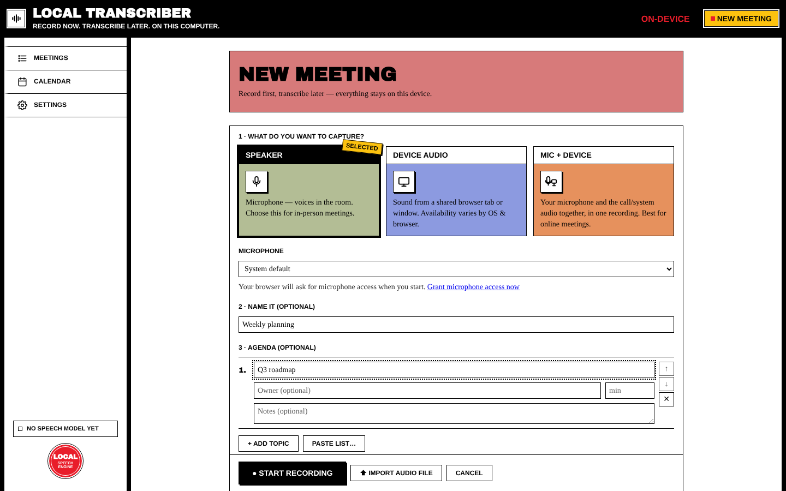
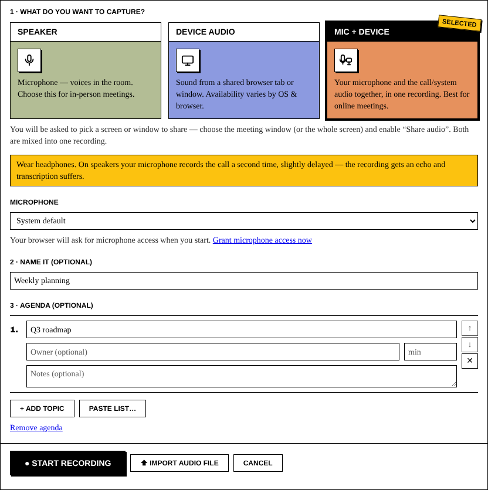
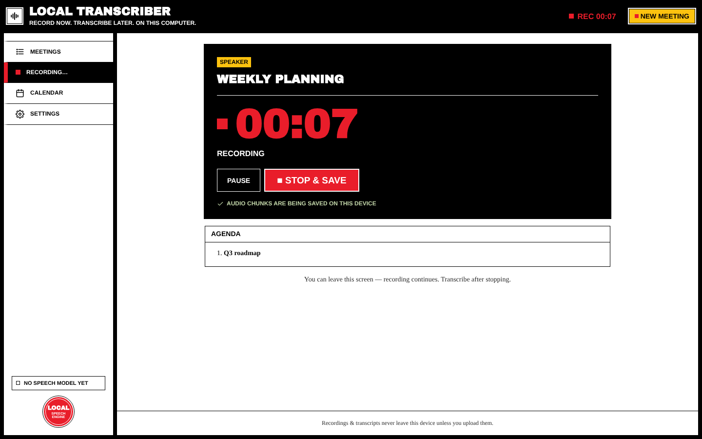
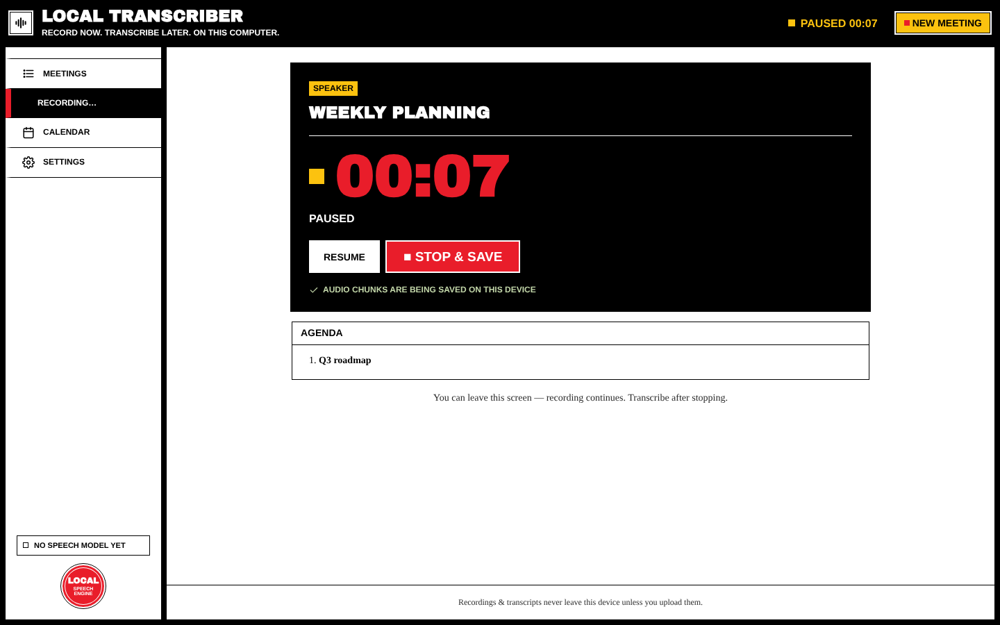
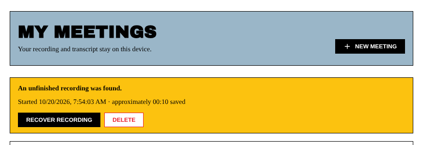

# Recording a Meeting

Recording is the core of the app, and it **never depends on AI**. Audio goes to disk in 5-second chunks while you talk, so a crash or power cut can't take the whole meeting.

## Start a new meeting

Click **New meeting** in the top bar or press `Ctrl+N` (`Cmd+N` on macOS).

### Step 1: what do you want to capture?

| Mode | Records | Use it for |
| --- | --- | --- |
| **Speaker** | Your microphone | In-person meetings, voices in the room |
| **Device Audio** | Everything your computer plays (call audio, videos). In the desktop app this is recorded directly, with no screen sharing. | Webinars, recordings of a call you only listen to |
| **Mic + Device** | Your microphone **and** the computer's audio, mixed into one recording | Zoom, Google Meet, Teams and other online calls |

> **Wear headphones for Mic + Device.** On speakers, your microphone picks up the call a second time, slightly delayed. The recording gets an echo and transcription gets worse.

Under the mode cards you can choose the **Microphone** (and, for device modes, the output device) to record from. The app remembers the last mode you used.

How system audio is captured on each platform:

| OS | Method |
| --- | --- |
| Windows | WASAPI loopback |
| macOS 14.2+ | CoreAudio tap. On older macOS, Device / Mic + Device may not be available; use **Speaker** or **Import audio file** instead. |
| Linux | PulseAudio / PipeWire |

### Step 2: name it (optional)

For example *Weekly planning*. You can rename it later.

### Step 3: agenda (optional)

Click **+ Add agenda** to plan topics. Each topic can have an **owner**, **minutes** and **notes**. Reorder topics with ↑/↓ and remove them with ✕. **Paste list…** turns a pasted list into topics. The agenda appears while you record and on the meeting page, and it's included in exports.

### Live transcription (optional)

If **Live transcription** is turned on (here or in Settings → Models), text appears a few seconds after each sentence, using a small, fast model on your device. That text is saved as the meeting's transcript. You can **Re-transcribe** later from the whole recording for better accuracy.

### Start

Press **● Start Recording**. The bar with Start, **⬆ Import audio file** and **Cancel** stays at the bottom of the window while you scroll.

## While recording

- The big red clock shows the elapsed time. The top bar shows **REC 00:07** on every screen.
- **Pause** / **Resume** (or press `P`) stops and restarts capture without ending the meeting.
- *"Audio chunks are being saved on this device"* means the crash-safe writing is working.
- **Audio problem detected** warns you about things like clipping (too loud) or silence while it can still be fixed. Recording carries on either way.
- Your **Agenda** and, if it's on, the **Live transcript** appear below.
- You can leave this screen, and recording continues. Click **Recording…** in the sidebar or the red clock to come back.

### Stop and save

Press **■ Stop & save** and confirm. The app finishes the audio file (*"Saving recording…"*) and opens the meeting page. Stopping is quick even after hours of recording.

If some audio couldn't be written to disk (for example, the disk was full), you'll see **Recording interrupted** and **Stop & keep what was saved**. The meeting is kept with whatever was saved.

## Import an existing audio file

On the New Meeting screen, click **⬆ Import audio file** and choose any audio file (also `.m4a` and `.mp4`). It becomes a meeting marked **Imported audio**, and you can play it and transcribe it like any recording.

## Crash recovery

If the app or your computer stops during a recording, the meetings list shows this the next time you open the app:

- **Recover Recording** puts the saved chunks back together into a meeting. The duration is estimated from the chunks.
- **Delete** (then **Yes, delete this audio**) throws the partial audio away.

Next: [[Transcription]]
