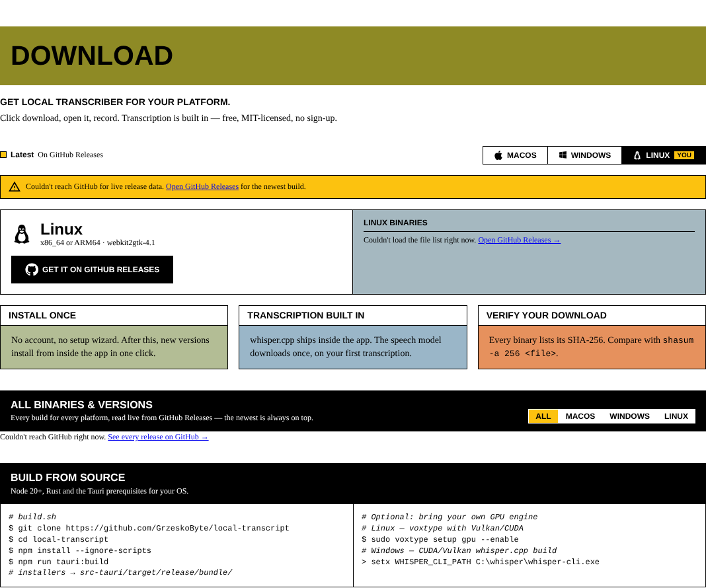

# Releases and Downloads

The download section reads the app repository's **GitHub Releases** live, on every visit:

```
GET https://api.github.com/repos/GrzeskoByte/local-transcript/releases?per_page=100
```

**Publishing a release updates the website, with no change to this repository.** The version number, hero button, file lists, release history and download counter all come from the API.

## Release layout

The app's `release.yml` workflow publishes **one release per platform** for each version:

| Release tag | Files |
| --- | --- |
| `v<ver>-windows` | `LocalTranscriber_<ver>_windows_{x64,arm64}-setup.exe`, `_windows_x64.msi` |
| `v<ver>-macos` | `LocalTranscriber_<ver>_macos_{arm64,x64}.dmg` |
| `v<ver>-ubuntu` | `LocalTranscriber_<ver>_linux_{amd64,arm64}.{deb,AppImage,rpm}` |

Every release also includes `SHA256SUMS.txt`.

## How the site reads them

- Tags matching `v<major>.<minor>.<patch>` with an optional `-windows` / `-macos` / `-ubuntu` suffix are merged into one entry per version.
- Other tags are ignored, for example the app's **`updater`** release that holds `latest.json`.
- Files that aren't installers are ignored: `.sig`, `.json`, `.txt`, `.tar.gz`, `.zip`, `.blockmap`.
- **Draft** releases aren't visible to the API, so they appear only once published.
- **Pre-releases** are listed (marked *Pre-release*) but never chosen as "latest" while a stable release exists.
- While a new version is still building for some platforms, each platform falls back to the newest release that has files for it.
- SHA-256 values come from GitHub's per-asset `digest` field.

## Publishing a new version (app repository)

1. Bump the version in `package.json`, `src-tauri/tauri.conf.json` and `src-tauri/Cargo.toml`.
2. `git tag v0.1.21 && git push origin v0.1.21`
3. The workflow builds on Windows, macOS and Ubuntu runners and creates three **draft** releases.
4. Review them on GitHub and **publish**. The website shows the new version within seconds.

## Limits and fallback

Unauthenticated GitHub API calls are limited to **60 requests per hour per IP**. If GitHub can't be reached, is rate-limited or takes longer than 8 seconds, the page shows a notice and every download button links to the [Releases page](https://github.com/GrzeskoByte/local-transcript/releases) instead.


