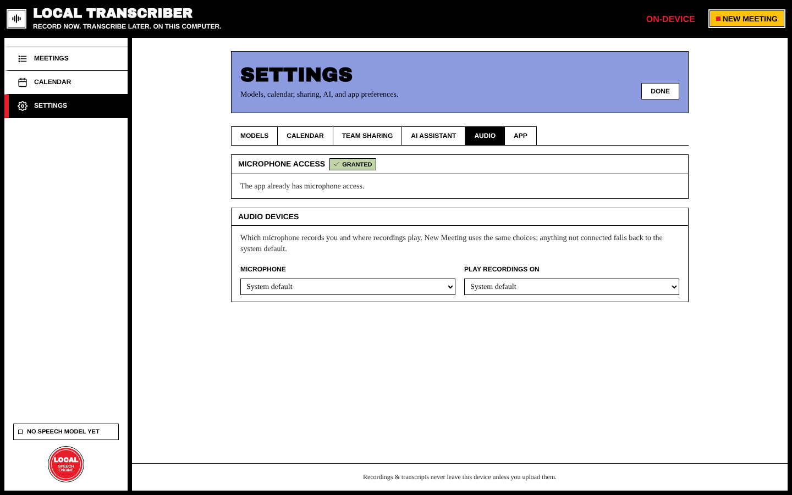
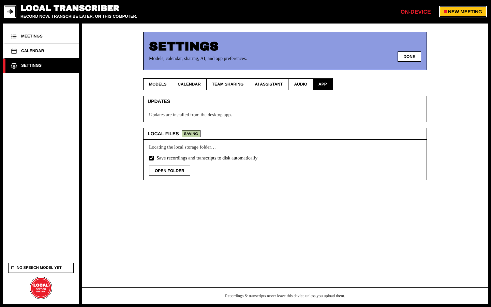

# Settings

Open **Settings** from the sidebar. It has six tabs. **Done** takes you back to your meetings.

## Models

| Section | What it does |
| --- | --- |
| **Desktop engine** | Shows the transcription engine that was found (built-in whisper.cpp, voxtype or `whisper-cli`) and the acceleration in use |
| **Transcribe after recording** | Optional (desktop). Transcribes each recording as soon as it stops. |
| **Live transcription** | Shows text while you record, using a small on-device model |
| **GPU acceleration** | Linux / voxtype: one-click enable for Vulkan/CUDA (may ask for your password) |
| **Spoken language** | Auto-detect, or a fixed default language |
| **Models** | The S–D tiered catalog. **Download**, select or remove models. |

Details: [[Transcription]].

## Calendar

The company calendar connection (CalDAV / Microsoft Graph / Exchange EWS), with **Find in Thunderbird**, **Detect from server** and **Use SOGo address**. Details: [[Calendar Integration]].

## Team sharing

GitLab instance, project, token and target (wiki page / issue / repository file). Details: [[GitLab Sharing]].

## AI assistant

LLM provider (Ollama, OpenAI-compatible, Open WebUI, OpenCode, Claude Code, Custom), base URL, completions path, API key and model. Details: [[AI Summaries]].

## Audio

| Section | What it does |
| --- | --- |
| **Microphone access** | Shows the permission state and lets you grant it |
| **Audio devices** | The default microphone and output devices used for recording and playback |

## App

| Section | What it does |
| --- | --- |
| **Updates** | **Check for updates**, plus a switch: *Check for updates when the app starts (contacts GitHub only)*. See [[Updates]]. In the browser preview it only says *"Updates are installed from the desktop app."* |
| **Local files** | *Save recordings and transcripts to disk automatically* copies each finished meeting to `<Documents>/Local Transcribe/<title-id>/`. **Open folder** opens it. |

> Settings screenshots were taken in the browser preview of the app. The desktop app shows the same tabs, plus engine, GPU and update details.
