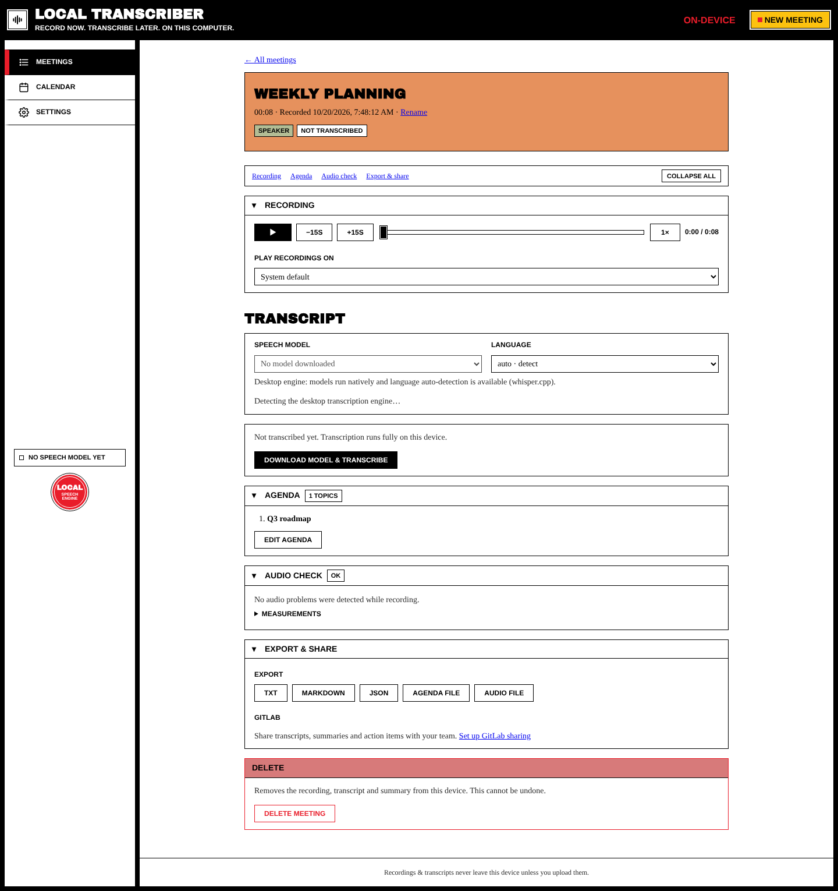
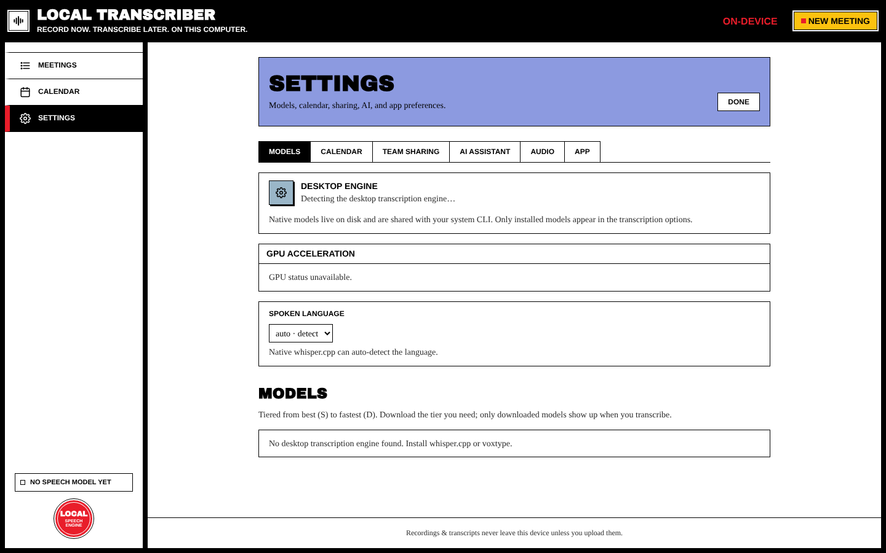

# Transcription

Transcription runs **on your computer** with whisper.cpp (built into the app) or with an engine you installed yourself (voxtype, or your own `whisper-cli` build). It's a separate, manual step after recording, and it **never changes the recording**. If it fails, your audio is still safe.

## Transcribe a meeting

Open a meeting from the list. If it hasn't been transcribed yet:

1. **Speech model**: choose one of your downloaded models. If you have none, the button says **Download model & transcribe** and gets the default model first.
2. **Language**: leave it on **auto · detect**, or choose the spoken language to get better results on short or mixed recordings.
3. Press **Transcribe**. You'll see each stage with progress. You can **Cancel** at any time.

Transcription carries on in the background, so you can open other meetings or start a new recording. The sidebar shows running transcriptions, and a notice tells you when one finishes.

When it's done, the transcript appears with a timestamp on each line. Use **Re-transcribe** (with a different model or language from **Model & language…**) whenever you like.

### If transcription fails

You'll see **Transcription failed.**, the reason, *"Your original recording is still safe."* and a **Retry** button. Common causes are listed in [[Troubleshooting#transcription]].

### Transcribe automatically

Settings → Models has an optional **Transcribe after recording** switch (desktop app), off by default. When it's on, each recording is transcribed as soon as you stop.

## Speech models

Settings → **Models** ranks every model in tiers, so you know what to pick:

| Tier | Meaning |
| --- | --- |
| **S · Best accuracy** | Maximum quality. Largest and slowest, worth it for important meetings. |
| **A · Great** | Near-top accuracy with a much smaller download |
| **B · Balanced** | Good everyday accuracy and speed |
| **C · Fast** | Quick drafts; expect noticeably more mistakes |
| **D · Fastest** | Smallest and quickest, lowest quality, mostly for testing |

**Recommendations**

- Start with **`large-v3-turbo`**. It's the default and a great balance of speed and accuracy.
- For the best accuracy, **`parakeet-tdt-0.6b-v3`** is at the top of the S tier. On Linux it needs voxtype's ONNX variant.
- For live transcription, use a small model such as `base`.

Click **Download** next to a model to get it (from Hugging Face, `ggerganov/whisper.cpp`). Only downloaded models appear in the transcription options. Models are stored on disk and shared with your system CLI. The `WHISPER_MODEL_DIR` environment variable changes the folder.

> The screenshot above was taken in the browser preview, which has no desktop engine. In the desktop app, this tab lists the engine that was found, the acceleration in use, and the model catalog.

## Language

Settings → Models → **Spoken language** sets the default (auto-detect or a fixed language). You can change it for each transcription on the meeting page.

## GPU acceleration

| Platform | How it works |
| --- | --- |
| **macOS** | Metal acceleration is built into whisper.cpp. Nothing to do. |
| **Linux** | Settings → Models → **GPU acceleration** has a one-click **Enable** button for voxtype (Vulkan/CUDA). It may ask for your password (polkit / sudo). Or run `sudo voxtype setup gpu --enable`. |
| **Windows** | Use a CUDA/Vulkan build of whisper.cpp and point the app at it: `setx WHISPER_CLI_PATH C:\whisper\whisper-cli.exe`. The GPU card is hidden on Windows. |

The **Desktop engine** card in Settings shows which engine and acceleration are in use.

## Bring your own engine

If `voxtype` or `whisper-cli` is installed on your system, the app finds it and uses it **instead of** the built-in engine. This is useful for GPU builds. Its models are listed automatically.

## Live transcription

Turn it on in Settings → Models (or on the New Meeting screen). While you record, text appears a few seconds after each sentence and is saved as the meeting's transcript (marked as a *live* transcript). It runs fully on your device with the built-in whisper.cpp. Use a small model. **Re-transcribe** afterwards gives the most accurate result from the whole recording.

Next: [[Meeting Details]]
