# Website Tour

A section-by-section guide to the Local Transcriber landing page. It's a single page with a navigation rail on the left and every section in the column on the right.

> The screenshots use sample release data (version 0.1.20). The live site always shows the newest real release from GitHub.

## Header and hero

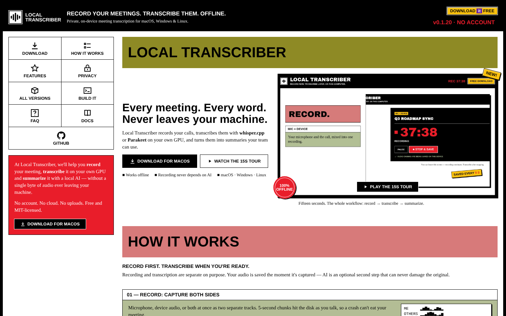

| Element | What it does |
| --- | --- |
| **Top banner** | Logo (a flat white tile with a black waveform, the same mark as the app's own header), tagline, the yellow **Download it FREE** sticker and the current version (**v0.1.20 · NO ACCOUNT**). The version comes live from GitHub. |
| **Navigation rail** | Download · How it works · Features · Privacy · All versions · Build it · FAQ · **Docs** (this wiki) · GitHub. It stays in view on desktop and highlights the section you're reading. On phones it becomes a horizontal strip. |
| **Red CTA block** | A short pitch and **Download for <your OS>** |
| **Hero** | Headline, **Download for <your OS>** (links straight to the recommended installer) and **Watch the 15s tour** |
| **Showreel** | A 15-second video of the record → transcribe → summarize workflow. Press **Play the 15s tour**. |

## How it works

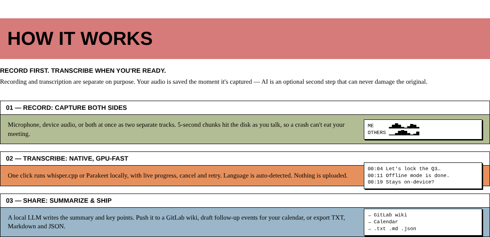

Three steps: **01 Record**, **02 Transcribe**, **03 Share**.

## Features

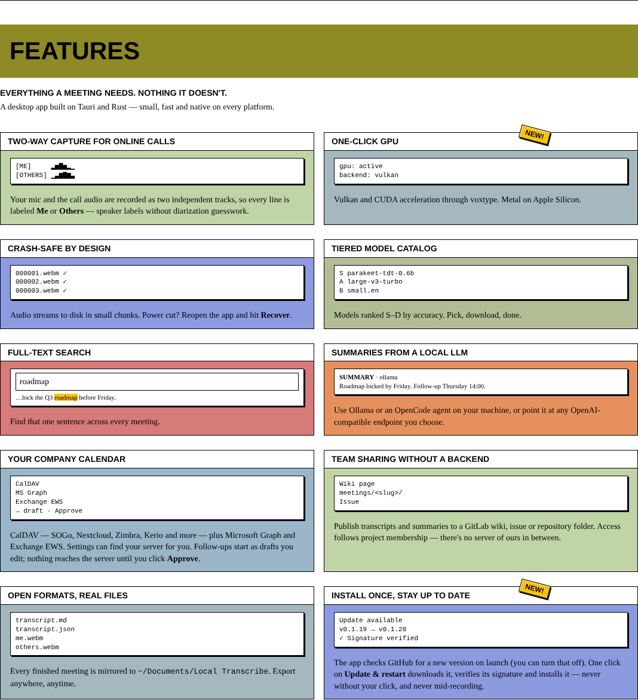

Ten cards: two-way capture, one-click GPU, crash-safe recording, the tiered model catalog, full-text search, local LLM summaries, company calendar, team sharing through GitLab, open file formats, and in-app updates. The version numbers on the *Install once, stay up to date* card (previous → newest) also come live from GitHub.

## Privacy

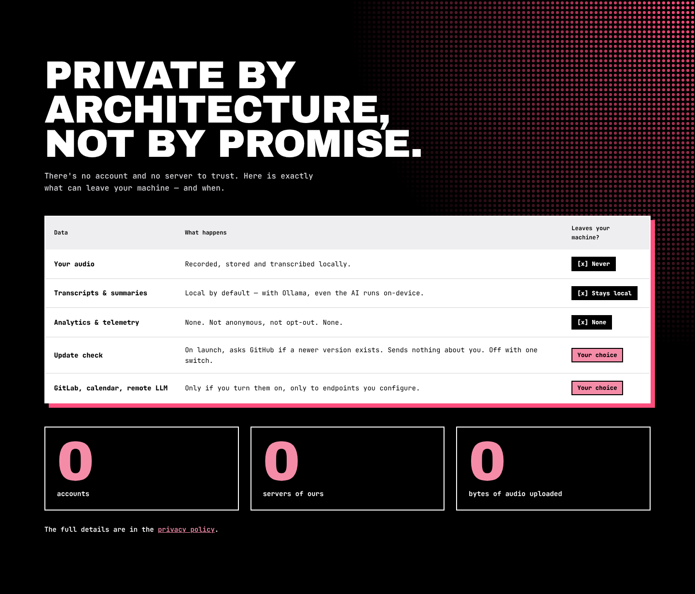

A table of exactly what can leave the user's computer, and when. Details: [[Privacy]].

## Download

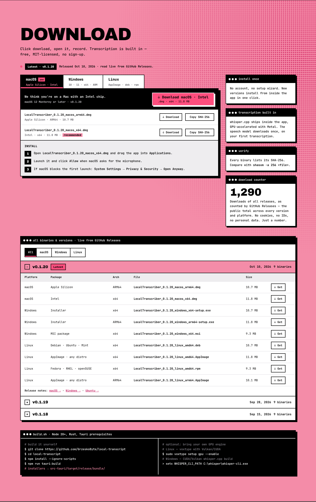

- **Release chip**: newest version and release date. The dot turns grey while loading or when offline.
- **Platform tabs**: **macOS / Windows / Linux**. Your platform is tagged **YOU**. Use the arrow keys to move between tabs.
- **Left panel**: the big download button for the recommended file (picked by OS and CPU), its file name, and numbered install steps. Commands have a **copy** button.
- **Right panel**: every file for that platform in the newest version, with package type, architecture, size, a short SHA-256 (copy button) and a **Download** button.
- **Info cards**: *Install once*, *Transcription built in*, and *Verify your download* (shows the right checksum command for the selected OS).

Per-platform views:

| macOS | Windows | Linux |
| --- | --- | --- |
| 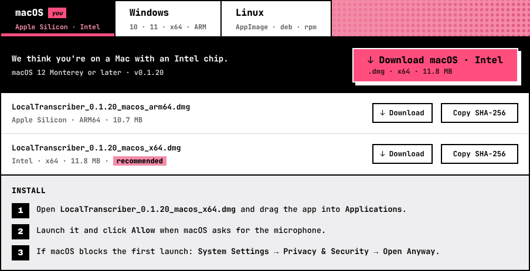 | 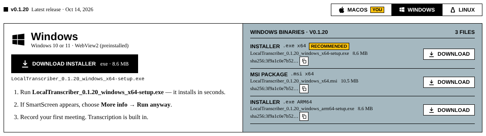 | 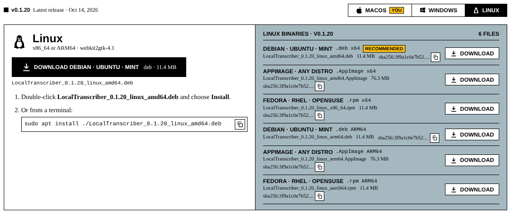 |

### Download counter

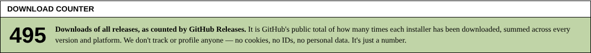

The total number of installer downloads across every release, as counted by GitHub. It's hidden if GitHub can't be reached. See [[Analytics and Download Counts]].

### All binaries & versions

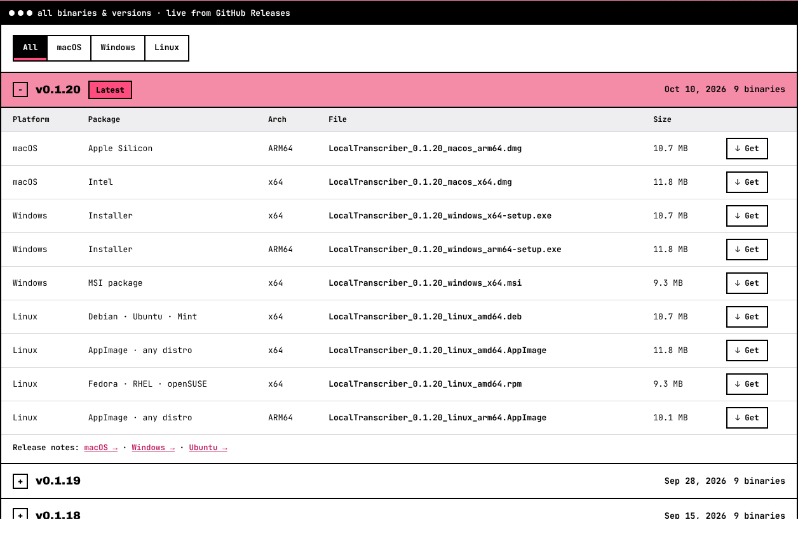

Every version, newest first. The latest one is expanded. Each version lists every binary (platform, package, architecture, file, size, **Get**) and links to each platform's release notes. Use **All / macOS / Windows / Linux** to filter.

### Build from source

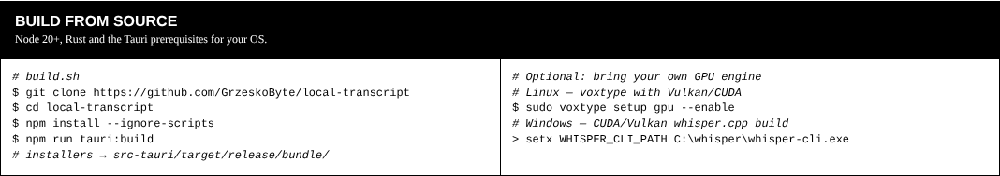

Commands to clone and build the app, and to plug in your own GPU engine.

### When GitHub can't be reached

A yellow notice appears, and every button links to the GitHub Releases page instead.

## FAQ

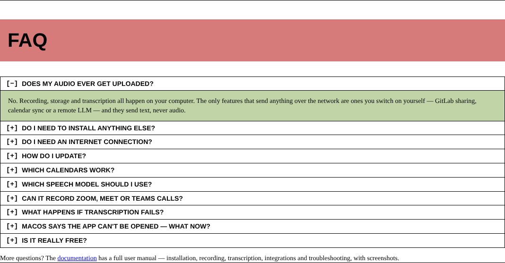

Ten questions that expand when clicked, followed by a link to this documentation. The same answers are in [[FAQ]].

## Footer

Home · Download · Releases · Docs · Source, plus copyright, the MIT license, **Privacy** and **Legal notice**.

## On a phone

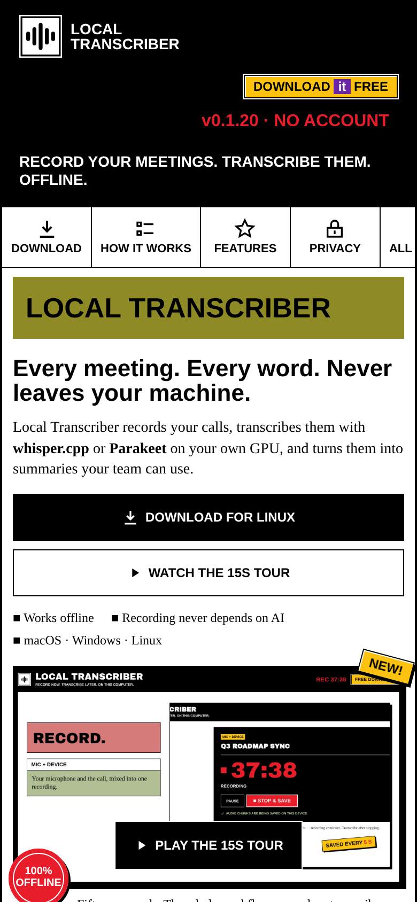

The layout adapts to phones, tablets, laptops and ultrawide screens. The page never scrolls sideways.
