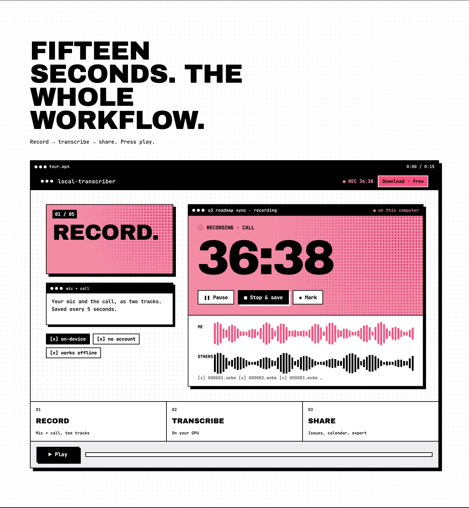
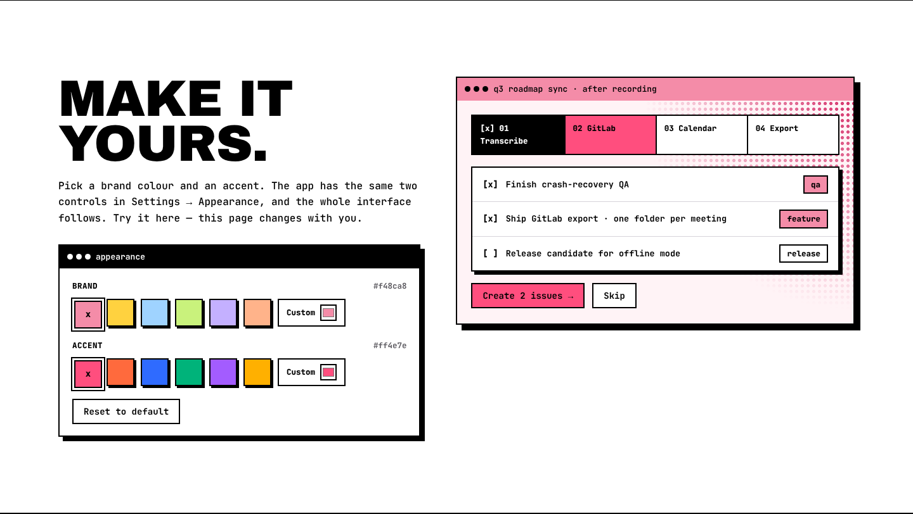

# Website Tour

A section-by-section guide to the Local Transcriber landing page. It's a single page of full-width bands under a sticky navigation window.

> The screenshots use sample release data (version 0.1.20). The live site always shows the newest real release from GitHub.

## Navigation and hero

| Element | What it does |
| --- | --- |
| **Navigation window** | Brand · How it works · Features · Privacy · All versions · FAQ · **Docs** (this wiki) · GitHub, then **Theme** and **Download · free**. It stays at the top and highlights the section you're reading. On phones and tablets only the brand, Theme and Download stay. |
| **Hero** | "Every meeting. Every word." over an animated halftone field that follows the pointer. **Download for <your OS>** links straight to the recommended installer; **Watch the 15s tour** jumps to the tour. Tags list the essentials and the current version (live from GitHub). |
| **App windows** | A recording window, a transcript and a summary, stacked like the app. |
| **Ticker** | No account · No cloud · No uploads · MIT · whisper.cpp · Parakeet · Ollama · platforms. |

## Fifteen-second tour

The showreel in a player window. **Play** starts it; the three phases (Record → Transcribe → Share) light up as the video reaches each scene, with a progress bar and timer. The scene start times live in `data-at` on `#phases` in `index.html` — update them if the showreel is replaced.

## How it works

Three steps: **01 Record**, **02 Transcribe**, **03 Share**.

## Features

Nine windows: two-way capture, one-click GPU, crash-safe recording, the tiered model catalog, full-text search, local LLM summaries, company calendar, team sharing through GitLab, and in-app updates. The version numbers on the *updates* window (previous → newest) come live from GitHub.

## Make it yours

Brand and accent swatches (plus a custom colour) recolour the whole page and the app preview next to them — the same two controls as the app's Settings → Appearance. **Theme** in the navigation opens the same picker anywhere on the page. The choice lasts for the current visit only; nothing is saved on the device.

## Privacy

A table of exactly what can leave the user's computer, and when, plus "0 accounts · 0 servers of ours · 0 bytes of audio uploaded". Details: [[Privacy]].

## Download

- **Release row**: newest version and release date. The lamp turns grey while loading or when offline.
- **Platform tabs**: **macOS / Windows / Linux**. Your platform is tagged **you**. Use the arrow keys to move between tabs.
- **Lead strip**: what we detected ("We think you're on a Mac with Apple Silicon") and the big download button for the recommended file (picked by OS and CPU).
- **File rows**: every file for that platform in the newest version, with package, architecture, size, **Download** and **Copy SHA-256**.
- **Install**: numbered steps for the recommended file. Commands have a **Copy** button.
- **Side windows**: *install once*, *transcription built in*, *verify* (the right checksum command for the selected OS) and the download counter.
- **On a phone**: a note explains the app runs on a computer, with **Send me the link** (share sheet, or copy).

Per-platform views:

| macOS | Windows | Linux |
| --- | --- | --- |
|  |  |  |

### Download counter

The total number of installer downloads across every release, as counted by GitHub. It's hidden if GitHub can't be reached. See [[Analytics and Download Counts]].

### All binaries & versions

Every version, newest first. The latest one is expanded. Each version lists every binary (platform, package, architecture, file, size, **Get**) and links to each platform's release notes. Use **All / macOS / Windows / Linux** to filter.

### Build from source

Commands to clone and build the app, and to plug in your own GPU engine.

### When GitHub can't be reached

A notice appears, and every button links to the GitHub Releases page instead.

## FAQ

Ten questions that expand when clicked, followed by a link to this documentation. The same answers are in [[FAQ]].

## Footer

Copyright and the MIT license, then Download · Releases · Docs · Source · **Privacy** · **Legal notice**.

## On a phone

The layout adapts to phones, tablets, laptops and ultrawide screens. The page never scrolls sideways.
